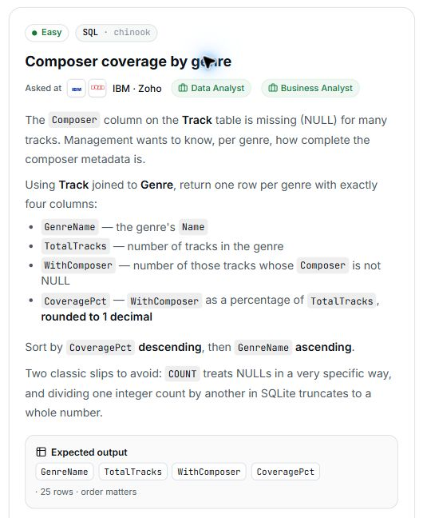

# 22. Composer coverage by genre

## Question and image

The `Composer` column on the **Track** table is missing (`NULL`) for many tracks. Management wants to know, per genre, how complete the composer metadata is.

Using **Track** joined to **Genre**, return one row per genre with exactly four columns:

- `GenreName` — the genre's `Name`.
- `TotalTracks` — number of tracks in the genre.
- `WithComposer` — number of those tracks whose `Composer` is not `NULL`.
- `CoveragePct` — `WithComposer` as a percentage of `TotalTracks`, **rounded to 1 decimal**.

Sort by `CoveragePct` **descending**, then `GenreName` **ascending**.

Two classic slips to avoid: `COUNT` treats `NULL`s in a very specific way, and dividing one integer count by another in SQLite truncates to a whole number.

**Expected output:** `GenreName`, `TotalTracks`, `WithComposer`, `CoveragePct` · 25 rows · order matters.



### Problem solving checklist

1. **Define the output:** state what one result row represents, the required columns, and the ordering.
2. **Understand the inputs:** identify table meanings, keys, relationships, duplicates, and NULLs.
3. **Explain the logic:** describe the steps, calculations, and comparisons in plain English.
4. **Choose SQL operations:** match each step to the SQL operations it needs.
5. **Plan intermediate results:** list the needed columns and what each intermediate row represents.
6. **Build gradually:** write one part, inspect its output, and check row counts after joins.
7. **Verify the answer:** check the sample, duplicates, missing matches, NULLs, arithmetic, boundaries, ties, and sorting.

Work through one step at a time during practice. Complete the current step before moving to the next.

## Schema

SQL table names are case-sensitive according to the question.

### Album

`AlbumId, Title, ArtistId`

### Artist

`ArtistId, Name`

### Customer

`CustomerId, FirstName, LastName, Company, Address, City, State, Country, PostalCode, Phone, Fax, Email, SupportRepId`

### Employee

`EmployeeId, LastName, FirstName, Title, ReportsTo, BirthDate, HireDate, Address, City, State, Country, PostalCode, Phone, Fax, Email`

### Genre

`GenreId, Name`

### Invoice

`InvoiceId, CustomerId, InvoiceDate, BillingAddress, BillingCity, BillingState, BillingCountry, BillingPostalCode, Total`

### InvoiceLine

`InvoiceLineId, InvoiceId, TrackId, UnitPrice, Quantity`

### MediaType

`MediaTypeId, Name`

### Playlist

`PlaylistId, Name`

### PlaylistTrack

`PlaylistId, TrackId`

### Track

`TrackId, Name, AlbumId, MediaTypeId, GenreId, Composer, Milliseconds, Bytes, UnitPrice`

## My solution — SQLite

```sql
select
    Genre.Name as GenreName,
    count(Track.TrackId) as TotalTracks,
    count(Track.Composer) as WithComposer,
    round(
        count(Track.Composer) * 100.0 / count(Track.TrackId),
        1
    ) as CoveragePct
from Track
join Genre on Track.GenreId = Genre.GenreId
group by Genre.GenreId, Genre.Name
order by CoveragePct desc, GenreName asc;
```

### Step-by-step explanation with one example

Use this small illustrative dataset throughout. It uses the question's actual table and column names; only columns needed for this explanation are shown. These are teaching rows, not the complete database or its expected row count. Every query result below was executed in SQLite on these same rows.

**Starting data**

`Genre`:

| GenreId | Name |
| --- | --- |
| 1 | Rock |
| 2 | Jazz |
| 3 | Pop |
| 4 | Classical |

`Track`:

| TrackId | GenreId | Composer |
| --- | --- | --- |
| 1 | 1 | A. Reed |
| 2 | 1 | NULL |
| 3 | 1 | B. Stone |
| 4 | 2 | C. Blue |
| 5 | 2 | D. Brass |
| 6 | 3 | NULL |

**1. Attach the genre to each track while retaining missing composers**

An inner join provides Genre.Name for each track. Do not filter out NULL Composer values: those tracks are part of the total whose coverage we measure.

```sql
SELECT Track.TrackId, Genre.Name AS GenreName, Track.Composer
FROM Track
JOIN Genre ON Track.GenreId = Genre.GenreId
ORDER BY Track.TrackId;
```

Result:

| TrackId | GenreName | Composer |
| --- | --- | --- |
| 1 | Rock | A. Reed |
| 2 | Rock | NULL |
| 3 | Rock | B. Stone |
| 4 | Jazz | C. Blue |
| 5 | Jazz | D. Brass |
| 6 | Pop | NULL |

All six tracks remain, including Rock track 2 and Pop track 6 with NULL composers. Classical has no matching track and produces no joined row.

**2. Count all tracks and populated composers separately**

COUNT(TrackId) counts every track because its ID is populated. COUNT(Composer) skips NULL, so it counts only tracks with composer information.

```sql
SELECT Genre.Name AS GenreName, COUNT(Track.TrackId) AS TotalTracks,
       COUNT(Track.Composer) AS WithComposer
FROM Track
JOIN Genre ON Track.GenreId = Genre.GenreId
GROUP BY Genre.GenreId, Genre.Name;
```

Result:

| GenreName | TotalTracks | WithComposer |
| --- | --- | --- |
| Rock | 3 | 2 |
| Jazz | 2 | 2 |
| Pop | 1 | 0 |

Rock has three tracks and two composers; Jazz has two and two; Pop has one and zero.

**3. Turn the two counts into a percentage**

Multiply the populated count by 100.0 before division to retain decimals, and ROUND to the requested one decimal place.

```sql
SELECT Genre.Name AS GenreName,
       COUNT(Track.Composer) * 100.0 / COUNT(Track.TrackId) AS UnroundedPct,
       ROUND(COUNT(Track.Composer) * 100.0 / COUNT(Track.TrackId), 1) AS CoveragePct
FROM Track
JOIN Genre ON Track.GenreId = Genre.GenreId
GROUP BY Genre.GenreId, Genre.Name;
```

Result:

| GenreName | UnroundedPct | CoveragePct |
| --- | --- | --- |
| Rock | 66.66666666666667 | 66.7 |
| Jazz | 100 | 100 |
| Pop | 0 | 0 |

Rock is 2 * 100.0 / 3 = 66.666..., which rounds to 66.7. Jazz is 100 and Pop is 0. The final query adds the counts and sorts highest coverage first.

**4. Assemble the final query**

Combine the steps using the saved solution. The query below preserves the original logic.

```sql
select
    Genre.Name as GenreName,
    count(Track.TrackId) as TotalTracks,
    count(Track.Composer) as WithComposer,
    round(
        count(Track.Composer) * 100.0 / count(Track.TrackId),
        1
    ) as CoveragePct
from Track
join Genre on Track.GenreId = Genre.GenreId
group by Genre.GenreId, Genre.Name
order by CoveragePct desc, GenreName asc;
```

Final result for this example:

| GenreName | TotalTracks | WithComposer | CoveragePct |
| --- | --- | --- | --- |
| Jazz | 2 | 2 | 100 |
| Rock | 3 | 2 | 66.7 |
| Pop | 1 | 0 | 0 |

**Check the result:** Jazz has 2/2 composers (100%), Rock has 2/3 (66.7%), and Pop has 0/1 (0%). The three TotalTracks values sum to six, including both missing-composer rows.

## My solution — SQL Server

```sql
select
    Genre.Name as GenreName,
    count(Track.TrackId) as TotalTracks,
    count(Track.Composer) as WithComposer,
    round(
        count(Track.Composer) * 100.0 / count(Track.TrackId),
        1
    ) as CoveragePct
from Track
join Genre on Track.GenreId = Genre.GenreId
group by Genre.GenreId, Genre.Name
order by CoveragePct desc, GenreName asc;
```

## Official solution

```sql
SELECT
    g.Name AS GenreName,
    COUNT(*) AS TotalTracks,
    COUNT(t.Composer) AS WithComposer,
    ROUND(100.0 * COUNT(t.Composer) / COUNT(*), 1) AS CoveragePct
FROM Track t
JOIN Genre g ON g.GenreId = t.GenreId
GROUP BY g.Name
ORDER BY CoveragePct DESC, GenreName ASC;
```

### What this tests

The difference between `COUNT(*)` and `COUNT(column)`, handling `NULL` values during aggregation, and avoiding integer division when calculating percentages.

`COUNT(*)` counts every row in a group. `COUNT(column)` counts only rows where that column is not `NULL`. Therefore, `COUNT(Track.Composer)` ignores tracks with a missing composer, while `COUNT(Track.TrackId)` counts every track because each track has a non-`NULL` `TrackId`.

### The approach

1. Join `Track` to `Genre` to obtain the genre name for every track.
2. Group the rows by genre.
3. Use `COUNT(*)` for all tracks and `COUNT(t.Composer)` for only tracks whose composer is not `NULL`.
4. Calculate the percentage with `100.0` to force decimal division, then round it to one decimal place.
5. Sort by coverage descending and genre name ascending.

### Why this way

`COUNT(column)` naturally ignores `NULL` values, making it a concise way to measure populated composer metadata. `SUM(CASE WHEN Composer IS NOT NULL THEN 1 ELSE 0 END)` is an equally valid, more explicit alternative.

### Common mistakes

- Using integer arithmetic when calculating the percentage, which can truncate the result.
- Using `COUNT(*)` for `WithComposer`, which makes every genre appear fully covered.
- Checking only for empty strings even though the missing composer values are `NULL`.
