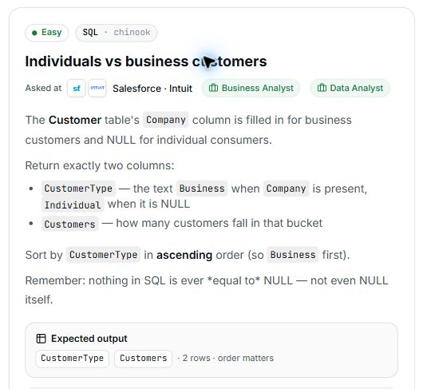

# 23. Individuals vs business customers

## Question and image

The **Customer** table's `Company` column is filled in for business customers and `NULL` for individual consumers.

Return exactly two columns:

- `CustomerType` — the text `Business` when `Company` is present, and `Individual` when it is `NULL`.
- `Customers` — how many customers fall into that bucket.

Sort by `CustomerType` in **ascending** order, so `Business` appears first.

Remember: nothing in SQL is ever equal to `NULL`—not even `NULL` itself.

**Expected output:** `CustomerType`, `Customers` · 2 rows · order matters.



### Problem solving checklist

1. **Define the output:** state what one result row represents, the required columns, and the ordering.
2. **Understand the inputs:** identify table meanings, keys, relationships, duplicates, and NULLs.
3. **Explain the logic:** describe the steps, calculations, and comparisons in plain English.
4. **Choose SQL operations:** match each step to the SQL operations it needs.
5. **Plan intermediate results:** list the needed columns and what each intermediate row represents.
6. **Build gradually:** write one part, inspect its output, and check row counts after joins.
7. **Verify the answer:** check the sample, duplicates, missing matches, NULLs, arithmetic, boundaries, ties, and sorting.

Work through one step at a time during practice. Complete the current step before moving to the next.

## Schema

SQL table names are case-sensitive according to the question.

### Album

`AlbumId, Title, ArtistId`

### Artist

`ArtistId, Name`

### Customer

`CustomerId, FirstName, LastName, Company, Address, City, State, Country, PostalCode, Phone, Fax, Email, SupportRepId`

### Employee

`EmployeeId, LastName, FirstName, Title, ReportsTo, BirthDate, HireDate, Address, City, State, Country, PostalCode, Phone, Fax, Email`

### Genre

`GenreId, Name`

### Invoice

`InvoiceId, CustomerId, InvoiceDate, BillingAddress, BillingCity, BillingState, BillingCountry, BillingPostalCode, Total`

### InvoiceLine

`InvoiceLineId, InvoiceId, TrackId, UnitPrice, Quantity`

### MediaType

`MediaTypeId, Name`

### Playlist

`PlaylistId, Name`

### PlaylistTrack

`PlaylistId, TrackId`

### Track

`TrackId, Name, AlbumId, MediaTypeId, GenreId, Composer, Milliseconds, Bytes, UnitPrice`

## My solution — SQLite

```sql
select
    case
        when Customer.Company is null then 'Individual'
        else 'Business'
    end as CustomerType,
    count(*) as Customers
from Customer
group by CustomerType
order by CustomerType;
```

### Step-by-step explanation with one example

Use this small illustrative dataset throughout. It uses the question's actual table and column names; only columns needed for this explanation are shown. These are teaching rows, not the complete database or its expected row count. Every query result below was executed in SQLite on these same rows.

**Starting data**

`Customer`:

| CustomerId | Company |
| --- | --- |
| 1 | NULL |
| 2 | Acme |
| 3 | NULL |
| 4 | Blue Ltd |
| 5 | Cedar Inc |

**1. Classify each customer from Company**

Use IS NULL to detect a missing company. CASE assigns Individual to those rows and Business to the others.

```sql
SELECT CustomerId, Company,
       CASE WHEN Customer.Company IS NULL THEN 'Individual' ELSE 'Business' END AS CustomerType
FROM Customer
ORDER BY CustomerId;
```

Result:

| CustomerId | Company | CustomerType |
| --- | --- | --- |
| 1 | NULL | Individual |
| 2 | Acme | Business |
| 3 | NULL | Individual |
| 4 | Blue Ltd | Business |
| 5 | Cedar Inc | Business |

Customers 1 and 3 become Individual. Customers 2, 4, and 5 become Business, even though their company names differ.

**2. Count rows per classification**

Group by the calculated CustomerType, then use COUNT(*) to include every row in both groups. Counting Company would skip the NULL values belonging to individuals.

```sql
SELECT CASE WHEN Customer.Company IS NULL THEN 'Individual' ELSE 'Business' END AS CustomerType,
       COUNT(*) AS Customers
FROM Customer
GROUP BY CustomerType;
```

Result:

| CustomerType | Customers |
| --- | --- |
| Business | 3 |
| Individual | 2 |

There are three Business customers and two Individual customers. The final ORDER BY makes Business appear first.

**3. Assemble the final query**

Combine the steps using the saved solution. The query below preserves the original logic.

```sql
select
    case
        when Customer.Company is null then 'Individual'
        else 'Business'
    end as CustomerType,
    count(*) as Customers
from Customer
group by CustomerType
order by CustomerType;
```

Final result for this example:

| CustomerType | Customers |
| --- | --- |
| Business | 3 |
| Individual | 2 |

**Check the result:** The two group counts add to five customers: 3 + 2 = 5. There is one row per customer type rather than one row per distinct company.

## My solution — SQL Server

```sql
select
    case
        when Customer.Company is null then 'Individual'
        else 'Business'
    end as CustomerType,
    count(*) as Customers
from Customer
group by
    case
        when Customer.Company is null then 'Individual'
        else 'Business'
    end
order by CustomerType;
```

## Official solution

```sql
SELECT
    CASE
        WHEN Company IS NULL THEN 'Individual'
        ELSE 'Business'
    END AS CustomerType,
    COUNT(*) AS Customers
FROM Customer
GROUP BY CustomerType
ORDER BY CustomerType ASC;
```

### What this tests

Creating a categorical label with `CASE`, grouping by that label, and applying SQL's rules for `NULL` values.

`COUNT(Customer.Company)` counts only non-`NULL` company values, so individual customers would be excluded. `COUNT(*)` counts every customer row in both groups.

`NULL` represents a missing or unknown value. Comparing it with `= NULL` does not return true—even when the other value is also `NULL`—because the result is unknown. Use `IS NULL` or `IS NOT NULL` when testing for missing values.

### The approach

1. Use `CASE` with `Company IS NULL` to classify each customer as `Individual` or `Business`.
2. Group by the derived `CustomerType` label. SQLite permits the select alias in `GROUP BY`; repeating the full `CASE` expression is more portable.
3. Count every row in each category with `COUNT(*)` and sort the labels alphabetically.

### Why this way

A `CASE` expression followed by `GROUP BY` is the standard pattern for assigning rows to calculated categories and summarizing each category. It also extends easily when another category is needed.

### Common mistakes

- Using `Company = NULL` or `Company != NULL`; both comparisons evaluate to unknown rather than true or false.
- Testing only for an empty string even though missing company values are stored as `NULL`.
- Grouping by `Company`, which produces one group per company rather than the required two customer types.
