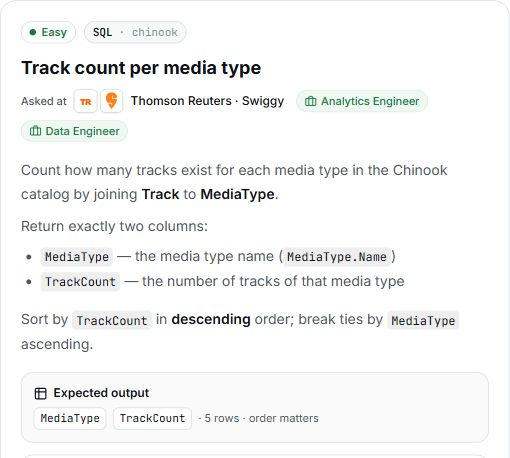

# 3. Track count per media type

## Question and image

Count how many tracks exist for each media type in the Chinook catalog by joining `Track` to `MediaType`.

Return exactly two columns:

- `MediaType` — the media type name (`MediaType.Name`).
- `TrackCount` — the number of tracks of that media type.

Sort by `TrackCount` in **descending** order; break ties by `MediaType` ascending.

**Expected output:** `MediaType`, `TrackCount` · 5 rows · order matters.



### Problem solving checklist

1. **Define the output:** state what one result row represents, the required columns, and the ordering.
2. **Understand the inputs:** identify table meanings, keys, relationships, duplicates, and NULLs.
3. **Explain the logic:** describe the steps, calculations, and comparisons in plain English.
4. **Choose SQL operations:** match each step to the SQL operations it needs.
5. **Plan intermediate results:** list the needed columns and what each intermediate row represents.
6. **Build gradually:** write one part, inspect its output, and check row counts after joins.
7. **Verify the answer:** check the sample, duplicates, missing matches, NULLs, arithmetic, boundaries, ties, and sorting.

Work through one step at a time during practice. Complete the current step before moving to the next.

## Schema

SQL table names are case-sensitive according to the question.

### Album

`AlbumId, Title, ArtistId`

### Artist

`ArtistId, Name`

### Customer

`CustomerId, FirstName, LastName, Company, Address, City, State, Country, PostalCode, Phone, Fax, Email, SupportRepId`

### Employee

`EmployeeId, LastName, FirstName, Title, ReportsTo, BirthDate, HireDate, Address, City, State, Country, PostalCode, Phone, Fax, Email`

### Genre

`GenreId, Name`

### Invoice

`InvoiceId, CustomerId, InvoiceDate, BillingAddress, BillingCity, BillingState, BillingCountry, BillingPostalCode, Total`

### InvoiceLine

`InvoiceLineId, InvoiceId, TrackId, UnitPrice, Quantity`

### MediaType

`MediaTypeId, Name`

### Playlist

`PlaylistId, Name`

### PlaylistTrack

`PlaylistId, TrackId`

### Track

`TrackId, Name, AlbumId, MediaTypeId, GenreId, Composer, Milliseconds, Bytes, UnitPrice`

## My solution — SQLite

```sql
select MediaType.Name as MediaType , count(TrackId) as TrackCount
from Track
join MediaType on Track.MediaTypeId = MediaType.MediaTypeId
group by (MediaType.MediaTypeId)
order by TrackCount desc , MediaType asc
```

### Step-by-step explanation with one example

Use this small illustrative dataset throughout. It uses the actual table and column names; only columns relevant to this question are shown. These rows are teaching data, not the complete Chinook database, so the number of results can differ from the prompt's full-database count.

**Starting data**

`MediaType`:

| MediaTypeId | Name |
| --- | --- |
| 1 | MPEG audio |
| 2 | AAC audio |
| 3 | WAV audio |
| 4 | MPEG video |
| 5 | AIFF audio |

`Track`:

| TrackId | Name | MediaTypeId |
| --- | --- | --- |
| 1 | North | 1 |
| 2 | South | 1 |
| 3 | East | 1 |
| 4 | West | 2 |
| 5 | Dawn | 2 |
| 6 | Dusk | 3 |
| 7 | Cloud | 4 |
| 8 | River | 5 |

**1. Attach the media type name to each track**

Track has MediaTypeId, while MediaType has the required descriptive name. Match those IDs.

```sql
SELECT Track.TrackId, Track.Name AS TrackName, MediaType.Name AS MediaType
FROM Track
JOIN MediaType ON Track.MediaTypeId = MediaType.MediaTypeId
ORDER BY Track.TrackId;
```

Result:

| TrackId | TrackName | MediaType |
| --- | --- | --- |
| 1 | North | MPEG audio |
| 2 | South | MPEG audio |
| 3 | East | MPEG audio |
| 4 | West | AAC audio |
| 5 | Dawn | AAC audio |
| 6 | Dusk | WAV audio |
| 7 | Cloud | MPEG video |
| 8 | River | AIFF audio |

Eight tracks remain. Three carry MPEG audio, two carry AAC audio, and each other media type has one track.

**2. Count tracks within each media type**

A group represents a media type rather than a track. Counting the non-NULL TrackId values counts tracks in that group.

```sql
SELECT MediaType.Name AS MediaType, COUNT(TrackId) AS TrackCount
FROM Track
JOIN MediaType ON Track.MediaTypeId = MediaType.MediaTypeId
GROUP BY MediaType.MediaTypeId;
```

Result:

| MediaType | TrackCount |
| --- | --- |
| MPEG audio | 3 |
| AAC audio | 2 |
| WAV audio | 1 |
| MPEG video | 1 |
| AIFF audio | 1 |

The eight joined rows become five counts. The saved inner join includes media types that have matching tracks; it does not manufacture a zero row for an empty media type.

**3. Assemble the final query**

Combine the steps using the saved solution. The query below preserves the original logic.

```sql
select MediaType.Name as MediaType , count(TrackId) as TrackCount
from Track
join MediaType on Track.MediaTypeId = MediaType.MediaTypeId
group by (MediaType.MediaTypeId)
order by TrackCount desc , MediaType asc
```

Final result for this example:

| MediaType | TrackCount |
| --- | --- |
| MPEG audio | 3 |
| AAC audio | 2 |
| AIFF audio | 1 |
| MPEG video | 1 |
| WAV audio | 1 |

**Check the result:** Sort by count descending: MPEG audio (3), AAC audio (2), then the three one-track types alphabetically as AIFF audio, MPEG video, WAV audio. All five counts sum to 8, matching the input tracks.

## My solution — SQL Server

```sql
select MediaType.Name as MediaType , count(TrackId) as TrackCount
from Track
join MediaType on Track.MediaTypeId = MediaType.MediaTypeId
group by MediaType.MediaTypeId, MediaType.Name
order by TrackCount desc , MediaType asc
```

## Official solution

```sql
SELECT m.Name AS MediaType,
       COUNT(*) AS TrackCount
FROM Track t
JOIN MediaType m ON t.MediaTypeId = m.MediaTypeId
GROUP BY m.Name
ORDER BY TrackCount DESC, MediaType ASC;
```

### What this tests

Joining tables, counting rows per group, using output aliases, and sorting.

### The approach

Join Track to MediaType on MediaTypeId; group by the media type name; count tracks; sort by count descending and name ascending.

### Why this way

Joining provides the descriptive name, and grouping produces one count per media type.

### Common mistakes

Returning MediaTypeId instead of the name, using incorrect aliases, omitting GROUP BY, or missing the join.
