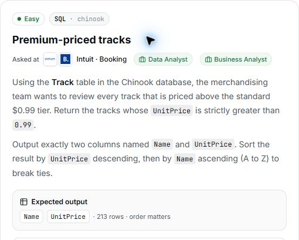

# 4. Premium-priced tracks

## Question and image

Using the `Track` table in the Chinook database, the merchandising team wants to review every track that is priced above the standard $0.99 tier. Return the tracks whose `UnitPrice` is **strictly greater than 0.99**.

Output exactly two columns named `Name` and `UnitPrice`.

Sort the result by `UnitPrice` descending, then by `Name` ascending (A to Z) to break ties.

**Expected output:** `Name`, `UnitPrice` · 213 rows · order matters.



### Problem solving checklist

1. **Define the output:** state what one result row represents, the required columns, and the ordering.
2. **Understand the inputs:** identify table meanings, keys, relationships, duplicates, and NULLs.
3. **Explain the logic:** describe the steps, calculations, and comparisons in plain English.
4. **Choose SQL operations:** match each step to the SQL operations it needs.
5. **Plan intermediate results:** list the needed columns and what each intermediate row represents.
6. **Build gradually:** write one part, inspect its output, and check row counts after joins.
7. **Verify the answer:** check the sample, duplicates, missing matches, NULLs, arithmetic, boundaries, ties, and sorting.

Work through one step at a time during practice. Complete the current step before moving to the next.

## Schema

SQL table names are case-sensitive according to the question.

### Album

`AlbumId, Title, ArtistId`

### Artist

`ArtistId, Name`

### Customer

`CustomerId, FirstName, LastName, Company, Address, City, State, Country, PostalCode, Phone, Fax, Email, SupportRepId`

### Employee

`EmployeeId, LastName, FirstName, Title, ReportsTo, BirthDate, HireDate, Address, City, State, Country, PostalCode, Phone, Fax, Email`

### Genre

`GenreId, Name`

### Invoice

`InvoiceId, CustomerId, InvoiceDate, BillingAddress, BillingCity, BillingState, BillingCountry, BillingPostalCode, Total`

### InvoiceLine

`InvoiceLineId, InvoiceId, TrackId, UnitPrice, Quantity`

### MediaType

`MediaTypeId, Name`

### Playlist

`PlaylistId, Name`

### PlaylistTrack

`PlaylistId, TrackId`

### Track

`TrackId, Name, AlbumId, MediaTypeId, GenreId, Composer, Milliseconds, Bytes, UnitPrice`

## My solution — SQLite

```sql
select Track.Name as Name , Track.UnitPrice as UnitPrice
from Track
where Track.UnitPrice > 0.99
order by Track.UnitPrice desc , Track.Name asc
```

### Step-by-step explanation with one example

Use this small illustrative dataset throughout. It uses the actual table and column names; only columns relevant to this question are shown. These rows are teaching data, not the complete Chinook database, so the number of results can differ from the prompt's full-database count.

**Starting data**

`Track`:

| TrackId | Name | UnitPrice |
| --- | --- | --- |
| 1 | Standard Song | 0.99 |
| 2 | Zebra | 1.99 |
| 3 | Alpha | 1.99 |
| 4 | Cinema | 2.99 |
| 5 | Budget Song | 0.49 |

**1. Retain prices strictly above the threshold**

The condition belongs in WHERE because it decides whether each track row qualifies. Strictly greater means the 0.99 boundary is excluded.

```sql
SELECT TrackId, Name, UnitPrice
FROM Track
WHERE UnitPrice > 0.99;
```

Result:

| TrackId | Name | UnitPrice |
| --- | --- | --- |
| 2 | Zebra | 1.99 |
| 3 | Alpha | 1.99 |
| 4 | Cinema | 2.99 |

Zebra, Alpha, and Cinema remain. Standard Song equals 0.99 and is excluded; Budget Song is below it.

**2. Return only the requested columns**

Projection controls the columns in the result. TrackId helped identify source rows but is not part of the required output.

```sql
SELECT Track.Name AS Name, Track.UnitPrice AS UnitPrice
FROM Track
WHERE Track.UnitPrice > 0.99;
```

Result:

| Name | UnitPrice |
| --- | --- |
| Zebra | 1.99 |
| Alpha | 1.99 |
| Cinema | 2.99 |

There are still three qualifying tracks, now with exactly Name and UnitPrice. No rows are grouped or combined.

**3. Assemble the final query**

Combine the steps using the saved solution. The query below preserves the original logic.

```sql
select Track.Name as Name , Track.UnitPrice as UnitPrice
from Track
where Track.UnitPrice > 0.99
order by Track.UnitPrice desc , Track.Name asc
```

Final result for this example:

| Name | UnitPrice |
| --- | --- |
| Cinema | 2.99 |
| Alpha | 1.99 |
| Zebra | 1.99 |

**Check the result:** The final order is Cinema at 2.99, then Alpha and Zebra at 1.99. Name ASC resolves the equal-price pair. The condition excludes 0.99 exactly, so changing > to >= would change the answer.

## My solution — SQL Server

```sql
select Track.Name as Name , Track.UnitPrice as UnitPrice
from Track
where Track.UnitPrice > 0.99
order by Track.UnitPrice desc , Track.Name asc
```

## Official solution

```sql
SELECT Name, UnitPrice
FROM Track
WHERE UnitPrice > 0.99
ORDER BY UnitPrice DESC, Name ASC;
```

### What this tests

Filtering rows with a numeric condition and sorting by multiple columns.

### The approach

Select Name and UnitPrice from Track; keep prices strictly above 0.99; sort by price descending, then name ascending.

### Why this way

WHERE directly removes rows outside the price requirement. A CASE expression in SELECT alone would not remove them.

### Common mistakes

Selecting extra columns, using >= instead of >, or reversing the sorting priority or direction.
