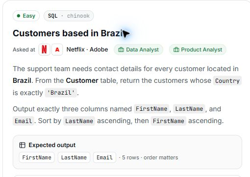

# 6. Customers based in Brazil

## Question and image

The support team needs contact details for every customer located in **Brazil**. From the `Customer` table, return the customers whose `Country` is exactly `'Brazil'`.

Output exactly three columns named `FirstName`, `LastName`, and `Email`.

Sort by `LastName` ascending, then `FirstName` ascending.

**Expected output:** `FirstName`, `LastName`, `Email` · 5 rows · order matters.



### Problem solving checklist

1. **Define the output:** state what one result row represents, the required columns, and the ordering.
2. **Understand the inputs:** identify table meanings, keys, relationships, duplicates, and NULLs.
3. **Explain the logic:** describe the steps, calculations, and comparisons in plain English.
4. **Choose SQL operations:** match each step to the SQL operations it needs.
5. **Plan intermediate results:** list the needed columns and what each intermediate row represents.
6. **Build gradually:** write one part, inspect its output, and check row counts after joins.
7. **Verify the answer:** check the sample, duplicates, missing matches, NULLs, arithmetic, boundaries, ties, and sorting.

Work through one step at a time during practice. Complete the current step before moving to the next.

## Schema

SQL table names are case-sensitive according to the question.

### Album

`AlbumId, Title, ArtistId`

### Artist

`ArtistId, Name`

### Customer

`CustomerId, FirstName, LastName, Company, Address, City, State, Country, PostalCode, Phone, Fax, Email, SupportRepId`

### Employee

`EmployeeId, LastName, FirstName, Title, ReportsTo, BirthDate, HireDate, Address, City, State, Country, PostalCode, Phone, Fax, Email`

### Genre

`GenreId, Name`

### Invoice

`InvoiceId, CustomerId, InvoiceDate, BillingAddress, BillingCity, BillingState, BillingCountry, BillingPostalCode, Total`

### InvoiceLine

`InvoiceLineId, InvoiceId, TrackId, UnitPrice, Quantity`

### MediaType

`MediaTypeId, Name`

### Playlist

`PlaylistId, Name`

### PlaylistTrack

`PlaylistId, TrackId`

### Track

`TrackId, Name, AlbumId, MediaTypeId, GenreId, Composer, Milliseconds, Bytes, UnitPrice`

## My solution — SQLite

```sql
select FirstName,LastName,Email
from Customer
where Country = 'Brazil'
order by LastName asc , FirstName asc
```

### Step-by-step explanation with one example

Use this small illustrative dataset throughout. It uses the actual table and column names; only columns relevant to this question are shown. These rows are teaching data, not the complete Chinook database, so the number of results can differ from the prompt's full-database count.

**Starting data**

`Customer`:

| CustomerId | FirstName | LastName | Country | Email |
| --- | --- | --- | --- | --- |
| 1 | Bruno | Silva | Brazil | bruno@example.com |
| 2 | Ana | Silva | Brazil | ana@example.com |
| 3 | Joao | Almeida | Brazil | joao@example.com |
| 4 | Maria | Costa | Portugal | maria@example.com |
| 5 | Luis | Almeida | Brazil | luis@example.com |

**1. Keep customers whose Country is Brazil**

Filter the actual Country column using the string literal Brazil. A person's name does not determine their location.

```sql
SELECT CustomerId, FirstName, LastName, Country, Email
FROM Customer
WHERE Country = 'Brazil';
```

Result:

| CustomerId | FirstName | LastName | Country | Email |
| --- | --- | --- | --- | --- |
| 1 | Bruno | Silva | Brazil | bruno@example.com |
| 2 | Ana | Silva | Brazil | ana@example.com |
| 3 | Joao | Almeida | Brazil | joao@example.com |
| 5 | Luis | Almeida | Brazil | luis@example.com |

Four customers remain. Maria is excluded because her Country is Portugal.

**2. Select the requested contact fields**

The result needs FirstName, LastName, and Email only. Country is used for filtering but need not be returned.

```sql
SELECT FirstName, LastName, Email
FROM Customer
WHERE Country = 'Brazil';
```

Result:

| FirstName | LastName | Email |
| --- | --- | --- |
| Bruno | Silva | bruno@example.com |
| Ana | Silva | ana@example.com |
| Joao | Almeida | joao@example.com |
| Luis | Almeida | luis@example.com |

The same four customers remain, with exactly the three required column names. There is no aggregation because one output row represents one customer.

**3. Assemble the final query**

Combine the steps using the saved solution. The query below preserves the original logic.

```sql
select FirstName,LastName,Email
from Customer
where Country = 'Brazil'
order by LastName asc , FirstName asc
```

Final result for this example:

| FirstName | LastName | Email |
| --- | --- | --- |
| Joao | Almeida | joao@example.com |
| Luis | Almeida | luis@example.com |
| Ana | Silva | ana@example.com |
| Bruno | Silva | bruno@example.com |

**Check the result:** LastName ASC places Almeida before Silva. Within Almeida, Joao comes before Luis; within Silva, Ana comes before Bruno. FirstName is the tie-breaker, not the primary sort key.

## My solution — SQL Server

```sql
select FirstName,LastName,Email
from Customer
where Country = 'Brazil'
order by LastName asc , FirstName asc
```

## Official solution

```sql
SELECT FirstName, LastName, Email
FROM Customer
WHERE Country = 'Brazil'
ORDER BY LastName ASC, FirstName ASC;
```

### What this tests

Selecting specific columns, filtering by a string value, and applying two-column sorting.

### The approach

Read Customer; keep Country = 'Brazil'; return FirstName, LastName, and Email; sort by last name, then first name.

### Why this way

Filtering and sorting in SQL returns only the requested customers and avoids doing that work in application code.

### Common mistakes

Changing the requested country condition, using SELECT *, or sorting by first name before last name.
