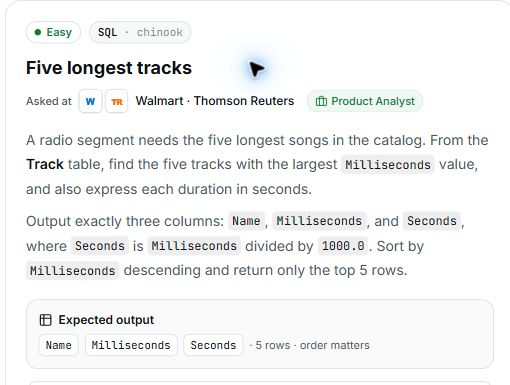

# 7. Five longest tracks

## Question and image

A radio segment needs the five longest songs in the catalog. From the `Track` table, find the five tracks with the largest `Milliseconds` value, and also express each duration in seconds.

Output exactly three columns: `Name`, `Milliseconds`, and `Seconds`, where `Seconds` is `Milliseconds` divided by `1000.0`.

Sort by `Milliseconds` descending and return only the top 5 rows.

**Expected output:** `Name`, `Milliseconds`, `Seconds` · 5 rows · order matters.



### Problem solving checklist

1. **Define the output:** state what one result row represents, the required columns, and the ordering.
2. **Understand the inputs:** identify table meanings, keys, relationships, duplicates, and NULLs.
3. **Explain the logic:** describe the steps, calculations, and comparisons in plain English.
4. **Choose SQL operations:** match each step to the SQL operations it needs.
5. **Plan intermediate results:** list the needed columns and what each intermediate row represents.
6. **Build gradually:** write one part, inspect its output, and check row counts after joins.
7. **Verify the answer:** check the sample, duplicates, missing matches, NULLs, arithmetic, boundaries, ties, and sorting.

Work through one step at a time during practice. Complete the current step before moving to the next.

## Schema

SQL table names are case-sensitive according to the question.

### Album

`AlbumId, Title, ArtistId`

### Artist

`ArtistId, Name`

### Customer

`CustomerId, FirstName, LastName, Company, Address, City, State, Country, PostalCode, Phone, Fax, Email, SupportRepId`

### Employee

`EmployeeId, LastName, FirstName, Title, ReportsTo, BirthDate, HireDate, Address, City, State, Country, PostalCode, Phone, Fax, Email`

### Genre

`GenreId, Name`

### Invoice

`InvoiceId, CustomerId, InvoiceDate, BillingAddress, BillingCity, BillingState, BillingCountry, BillingPostalCode, Total`

### InvoiceLine

`InvoiceLineId, InvoiceId, TrackId, UnitPrice, Quantity`

### MediaType

`MediaTypeId, Name`

### Playlist

`PlaylistId, Name`

### PlaylistTrack

`PlaylistId, TrackId`

### Track

`TrackId, Name, AlbumId, MediaTypeId, GenreId, Composer, Milliseconds, Bytes, UnitPrice`

## My solution — SQLite

```sql
select Name,Milliseconds, (Milliseconds/1000.0) as Seconds
from Track
order by Milliseconds desc
limit 5
```

### Step-by-step explanation with one example

Use this small illustrative dataset throughout. It uses the question's actual table and column names; only columns needed for this explanation are shown. These are teaching rows, not the complete database or its expected row count. Every query result below was executed in SQLite on these same rows.

**Starting data**

`Track`:

| TrackId | Name | Milliseconds |
| --- | --- | --- |
| 1 | Alpha | 150000 |
| 2 | Echo | 500500 |
| 3 | Beta | 120000 |
| 4 | Gamma | 400000 |
| 5 | Delta | 600125 |
| 6 | Foxtrot | 300000 |
| 7 | Grove | 200000 |

**1. Calculate seconds for each track**

One output row still represents one track. Dividing by 1000.0 converts milliseconds into seconds and keeps the fractional part.

```sql
SELECT Name, Milliseconds, Milliseconds / 1000.0 AS Seconds
FROM Track;
```

Result:

| Name | Milliseconds | Seconds |
| --- | --- | --- |
| Alpha | 150000 | 150 |
| Echo | 500500 | 500.5 |
| Beta | 120000 | 120 |
| Gamma | 400000 | 400 |
| Delta | 600125 | 600.125 |
| Foxtrot | 300000 | 300 |
| Grove | 200000 | 200 |

Delta becomes 600.125 seconds. The calculation changes the displayed value without merging or removing any tracks.

**2. Put the longest tracks first**

Sorting must happen before the five-row limit, so the limit keeps the five largest durations.

```sql
SELECT Name, Milliseconds, Milliseconds / 1000.0 AS Seconds
FROM Track
ORDER BY Milliseconds DESC;
```

Result:

| Name | Milliseconds | Seconds |
| --- | --- | --- |
| Delta | 600125 | 600.125 |
| Echo | 500500 | 500.5 |
| Gamma | 400000 | 400 |
| Foxtrot | 300000 | 300 |
| Grove | 200000 | 200 |
| Alpha | 150000 | 150 |
| Beta | 120000 | 120 |

There are seven rows here. LIMIT 5 in the assembled query will remove Alpha and Beta, the two shortest tracks.

**3. Assemble the final query**

Combine the steps using the saved solution. The query below preserves the original logic.

```sql
select Name,Milliseconds, (Milliseconds/1000.0) as Seconds
from Track
order by Milliseconds desc
limit 5
```

Final result for this example:

| Name | Milliseconds | Seconds |
| --- | --- | --- |
| Delta | 600125 | 600.125 |
| Echo | 500500 | 500.5 |
| Gamma | 400000 | 400 |
| Foxtrot | 300000 | 300 |
| Grove | 200000 | 200 |

**Check the result:** Delta, Echo, Gamma, Foxtrot, and Grove have the five largest Milliseconds values. Their seconds are their original durations divided by 1000.0; seven input tracks become five output rows.

## My solution — SQL Server

```sql
select TOP (5) Name,Milliseconds, (Milliseconds/1000.0) as Seconds
from Track
order by Milliseconds desc
```

## Official solution

```sql
SELECT Name, Milliseconds, Milliseconds / 1000.0 AS Seconds
FROM Track
ORDER BY Milliseconds DESC
LIMIT 5;
```

### What this tests

Selecting columns, calculating a derived value, sorting, and limiting results.

### The approach

Return each track's name and duration; divide Milliseconds by 1000.0 for Seconds; sort longest first; keep five rows.

### Why this way

ORDER BY with LIMIT is a direct way to retrieve the top five across the whole table.

### Common mistakes

Returning the wrong columns, omitting LIMIT 5, or using integer division and losing fractional seconds.
