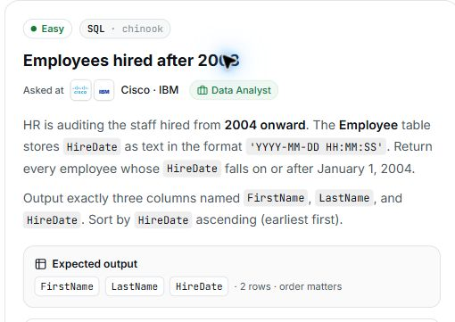

# 8. Employees hired after 2003

## Question and image

HR is auditing the staff hired from **2004 onward**. The `Employee` table stores `HireDate` as text in the format `'YYYY-MM-DD HH:MM:SS'`. Return every employee whose `HireDate` falls **on or after January 1, 2004**.

Output exactly three columns named `FirstName`, `LastName`, and `HireDate`.

Sort by `HireDate` ascending (earliest first).

**Expected output:** `FirstName`, `LastName`, `HireDate` · 2 rows · order matters.



### Problem solving checklist

1. **Define the output:** state what one result row represents, the required columns, and the ordering.
2. **Understand the inputs:** identify table meanings, keys, relationships, duplicates, and NULLs.
3. **Explain the logic:** describe the steps, calculations, and comparisons in plain English.
4. **Choose SQL operations:** match each step to the SQL operations it needs.
5. **Plan intermediate results:** list the needed columns and what each intermediate row represents.
6. **Build gradually:** write one part, inspect its output, and check row counts after joins.
7. **Verify the answer:** check the sample, duplicates, missing matches, NULLs, arithmetic, boundaries, ties, and sorting.

Work through one step at a time during practice. Complete the current step before moving to the next.

## Schema

SQL table names are case-sensitive according to the question.

### Album

`AlbumId, Title, ArtistId`

### Artist

`ArtistId, Name`

### Customer

`CustomerId, FirstName, LastName, Company, Address, City, State, Country, PostalCode, Phone, Fax, Email, SupportRepId`

### Employee

`EmployeeId, LastName, FirstName, Title, ReportsTo, BirthDate, HireDate, Address, City, State, Country, PostalCode, Phone, Fax, Email`

### Genre

`GenreId, Name`

### Invoice

`InvoiceId, CustomerId, InvoiceDate, BillingAddress, BillingCity, BillingState, BillingCountry, BillingPostalCode, Total`

### InvoiceLine

`InvoiceLineId, InvoiceId, TrackId, UnitPrice, Quantity`

### MediaType

`MediaTypeId, Name`

### Playlist

`PlaylistId, Name`

### PlaylistTrack

`PlaylistId, TrackId`

### Track

`TrackId, Name, AlbumId, MediaTypeId, GenreId, Composer, Milliseconds, Bytes, UnitPrice`

## My solution — SQLite

```sql
select FirstName,LastName,HireDate
from Employee
where HireDate >= '2004-01-01 00:00:00'
order by HireDate asc
```

### Step-by-step explanation with one example

Use this small illustrative dataset throughout. It uses the question's actual table and column names; only columns needed for this explanation are shown. These are teaching rows, not the complete database or its expected row count. Every query result below was executed in SQLite on these same rows.

**Starting data**

`Employee`:

| EmployeeId | FirstName | LastName | HireDate |
| --- | --- | --- | --- |
| 1 | Eva | Chen | 2005-06-15 09:00:00 |
| 2 | Omar | Lee | 2003-12-31 23:59:59 |
| 3 | Jane | Adams | 2004-01-01 00:00:00 |

**1. Keep employees hired from the start of 2004**

The requirement includes January 1, so use >= rather than >. The fixed YYYY-MM-DD HH:MM:SS text format compares in chronological order.

```sql
SELECT FirstName, LastName, HireDate
FROM Employee
WHERE HireDate >= '2004-01-01 00:00:00';
```

Result:

| FirstName | LastName | HireDate |
| --- | --- | --- |
| Eva | Chen | 2005-06-15 09:00:00 |
| Jane | Adams | 2004-01-01 00:00:00 |

Omar is removed because his HireDate is before the boundary. Jane is retained because her timestamp equals the boundary. Eva is also retained.

**2. Assemble the final query**

Combine the steps using the saved solution. The query below preserves the original logic.

```sql
select FirstName,LastName,HireDate
from Employee
where HireDate >= '2004-01-01 00:00:00'
order by HireDate asc
```

Final result for this example:

| FirstName | LastName | HireDate |
| --- | --- | --- |
| Jane | Adams | 2004-01-01 00:00:00 |
| Eva | Chen | 2005-06-15 09:00:00 |

**Check the result:** Exactly Jane and Eva qualify. Sorting the retained rows by HireDate puts Jane first, followed by Eva.

## My solution — SQL Server

```sql
select FirstName,LastName,HireDate
from Employee
where HireDate >= '2004-01-01 00:00:00'
order by HireDate asc
```

## Official solution

```sql
SELECT FirstName, LastName, HireDate
FROM Employee
WHERE HireDate >= '2004-01-01 00:00:00'
ORDER BY HireDate ASC;
```

### What this tests

Filtering and sorting dates stored as consistently formatted text.

### The approach

Return FirstName, LastName, and HireDate; include dates on or after the start of 2004; sort earliest first.

### Why this way

The fixed YYYY-MM-DD HH:MM:SS format sorts chronologically as text, so this comparison does not require a date-conversion function.

### Common mistakes

Selecting the wrong columns, omitting the filter, using > instead of >=, or adding unnecessary date conversion.
