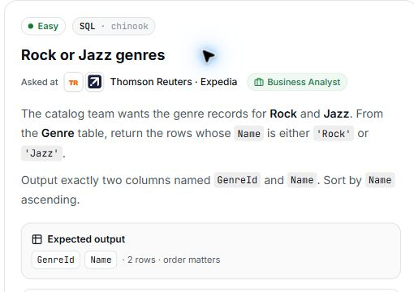

# 9. Rock or Jazz genres

## Question and image

The catalog team wants the genre records for **Rock** and **Jazz**. From the **Genre** table, return the rows whose `Name` is either `'Rock'` or `'Jazz'`.

Output exactly two columns named `GenreId` and `Name`.

Sort by `Name` ascending.

**Expected output:** `GenreId`, `Name` · 2 rows · order matters.



### Problem solving checklist

1. **Define the output:** state what one result row represents, the required columns, and the ordering.
2. **Understand the inputs:** identify table meanings, keys, relationships, duplicates, and NULLs.
3. **Explain the logic:** describe the steps, calculations, and comparisons in plain English.
4. **Choose SQL operations:** match each step to the SQL operations it needs.
5. **Plan intermediate results:** list the needed columns and what each intermediate row represents.
6. **Build gradually:** write one part, inspect its output, and check row counts after joins.
7. **Verify the answer:** check the sample, duplicates, missing matches, NULLs, arithmetic, boundaries, ties, and sorting.

Work through one step at a time during practice. Complete the current step before moving to the next.

## Schema

SQL table names are case-sensitive according to the question.

### Album

`AlbumId, Title, ArtistId`

### Artist

`ArtistId, Name`

### Customer

`CustomerId, FirstName, LastName, Company, Address, City, State, Country, PostalCode, Phone, Fax, Email, SupportRepId`

### Employee

`EmployeeId, LastName, FirstName, Title, ReportsTo, BirthDate, HireDate, Address, City, State, Country, PostalCode, Phone, Fax, Email`

### Genre

`GenreId, Name`

### Invoice

`InvoiceId, CustomerId, InvoiceDate, BillingAddress, BillingCity, BillingState, BillingCountry, BillingPostalCode, Total`

### InvoiceLine

`InvoiceLineId, InvoiceId, TrackId, UnitPrice, Quantity`

### MediaType

`MediaTypeId, Name`

### Playlist

`PlaylistId, Name`

### PlaylistTrack

`PlaylistId, TrackId`

### Track

`TrackId, Name, AlbumId, MediaTypeId, GenreId, Composer, Milliseconds, Bytes, UnitPrice`

## My solution — SQLite

```sql
select GenreId,Name
from Genre
where Name In('Rock','Jazz')
order by Name asc
```

### Step-by-step explanation with one example

Use this small illustrative dataset throughout. It uses the question's actual table and column names; only columns needed for this explanation are shown. These are teaching rows, not the complete database or its expected row count. Every query result below was executed in SQLite on these same rows.

**Starting data**

`Genre`:

| GenreId | Name |
| --- | --- |
| 1 | Rock |
| 2 | Jazz |
| 3 | Pop |
| 4 | Classical |

**1. Keep either of the two requested names**

IN tests whether one value belongs to the allowed list. A row qualifies when its Name is Rock or Jazz.

```sql
SELECT GenreId, Name
FROM Genre
WHERE Name IN ('Rock', 'Jazz');
```

Result:

| GenreId | Name |
| --- | --- |
| 1 | Rock |
| 2 | Jazz |

Rock and Jazz remain. Pop and Classical are removed. A single name does not need to equal both allowed values.

**2. Assemble the final query**

Combine the steps using the saved solution. The query below preserves the original logic.

```sql
select GenreId,Name
from Genre
where Name In('Rock','Jazz')
order by Name asc
```

Final result for this example:

| GenreId | Name |
| --- | --- |
| 2 | Jazz |
| 1 | Rock |

**Check the result:** There are two qualifying genres. ORDER BY Name ASC places Jazz before Rock.

## My solution — SQL Server

```sql
select GenreId,Name
from Genre
where Name In('Rock','Jazz')
order by Name asc
```

## Official solution

```sql
SELECT GenreId, Name
FROM Genre
WHERE Name IN ('Rock', 'Jazz')
ORDER BY Name ASC;
```

### What this tests

Filtering one column against several specific values using IN.

### The approach

Select GenreId and Name; keep Rock or Jazz with IN; sort by name ascending.

### Why this way

IN expresses the allowed values concisely and is easier to extend than repeated OR conditions.

### Common mistakes

Using AND between the two names, filtering for only one genre, or returning incorrect columns.
