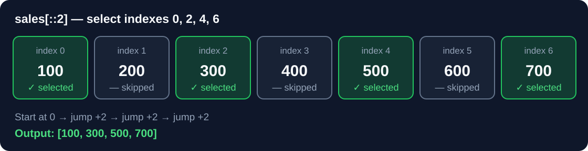

# Python Lists & Slicing — Foundation Notes

## Why do we need this?

A data pipeline receives thousands of sales values. You often need to **keep valid amounts**, inspect a recent batch or sample every second record. A Python **list** stores ordered values; **slicing** selects part of that list without modifying the original list.

**JavaScript connection:** Python `list` is the closest everyday equivalent of a JS `Array`. Python's `[start:stop:step]` extends the idea of JS `array.slice(start, stop)`.

## 1. Lists are ordered and mutable

```python
sales = [100, 200, 300, 400]
sales.append(500)
sales[0] = 50
print(sales)       # [50, 200, 300, 400, 500]
print(sales[-1])   # 500 (last item)
print(len(sales))  # 5
```

**How it works:** `append()` adds an item to the end; `sales[0]` changes the first value. Lists allow duplicate values and multiple data types.

| JavaScript | Python |
|---|---|
| `arr.push(500)` | `arr.append(500)` |
| `arr.length` | `len(arr)` |
| `arr.at(-1)` | `arr[-1]` |
| `arr.slice(1, 3)` | `arr[1:3]` |

## 2. Why slicing?

Sometimes you only need some of the records, not a loop that processes everything.

**Syntax:** `items[start:stop:step]`

| Part | Meaning | Rule |
|---|---|---|
| `start` | First selected index | Included |
| `stop` | Boundary index | Excluded |
| `step` | How far to jump each time | `2` = every second index |

```python
sales = [100, 200, 300, 400, 500, 600, 700]
print(sales[::2])
```

**Output:** `[100, 300, 500, 700]`

### Visual explanation



- Start at **index 0** → value **100**
- Jump two indexes → index **2** → **300**
- Jump two again → index **4** → **500**
- Jump two again → index **6** → **700**

**Important:** Step `2` means jump **two positions**, *not* return two elements.

### Common slicing patterns

```python
print(sales[:3])    # [100, 200, 300]                  first three
print(sales[-3:])   # [500, 600, 700]                  last three
print(sales[::2])   # [100, 300, 500, 700]             alternate items
print(sales[::-1])  # [700, 600, 500, 400, 300, 200, 100] reverse
```

**Why `[::-1]` reverses:** An omitted starting index with step `-1` begins at the last element and walks backward one position at a time. `sales[-1]` returns one value, but `sales[::-1]` returns a new reversed list.

## 3. ETL example: clean incoming sales

```python
raw_sales = [1200, 1500, -300, 1800, 0, 2200]
cleaned_sales = []
for amount in raw_sales:
    if amount > 0:
        cleaned_sales.append(amount)
print(cleaned_sales)       # [1200, 1500, 1800, 2200]
print(len(cleaned_sales))  # 4
```

**Progressive result:**

| Read | Keep? | `cleaned_sales` after step |
|---:|---|---|
| 1200 | Yes | `[1200]` |
| 1500 | Yes | `[1200,1500]` |
| -300 | No | `[1200,1500]` |
| 1800 | Yes | `[1200,1500,1800]` |
| 0 | No | `[1200,1500,1800]` |
| 2200 | Yes | `[1200,1500,1800,2200]` |

The original `raw_sales` list is not changed. This is a simple **extract → validate → create cleaned output** transformation.

## Revision essentials

- Indexing: `sales[1]` is a **single value**; `sales[1:2]` is a **one-element list**.
- `sales[1::2]` starts from the second value; `sales[::2]` starts from the first.
- `sales[-1:-3]` returns an empty list with the default positive step.
- `sales[::-2]` goes backwards by two positions starting at the last element.
- Slicing copies the outer list but not necessarily nested objects; a slice is **shallow**.

## Source links and coverage

| Source | Unique contribution / reference |
|---|---|
| Bosscoder | [Python Refresher 1 source audit](../../../99.%20Reference%20Materials/Legacy%20Journey%20Snapshot/02-python/bosscoder/python-refresher-1-coverage.md), including indexing/slicing coverage |
| PNP mentorship | [Original 80-page PDF](../../../2.%20Python%20Mastry/Source/1793477658005.pdf) · [PDF-aligned list lesson](../../../2.%20Python%20Mastry/1.%20Python%20from%20Zero/10.%20Lists%20-%20ordered%20collections.md) |
| W3Schools | [Official Python Lists](https://www.w3schools.com/python/python_lists.asp); original explanations here, not copied content |
| ChatGPT Study Mode | Lesson 11B sales cleaning + Lesson 11D slicing, independently corrected; detailed historical attempts retained in the Journey snapshot |

**Mastery state:** Lesson 11 guided exercises reviewed; slicing steps remain in spaced revision. This note does not claim the mentorship PDF pages or a Bosscoder assignment were independently completed.
